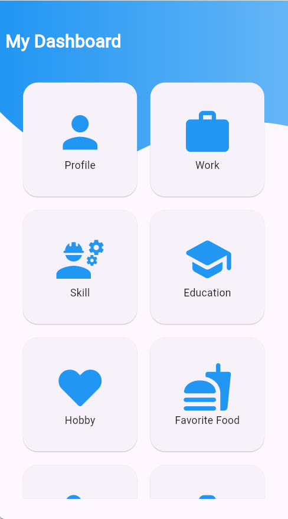
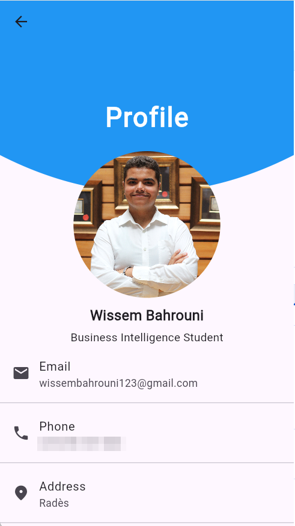
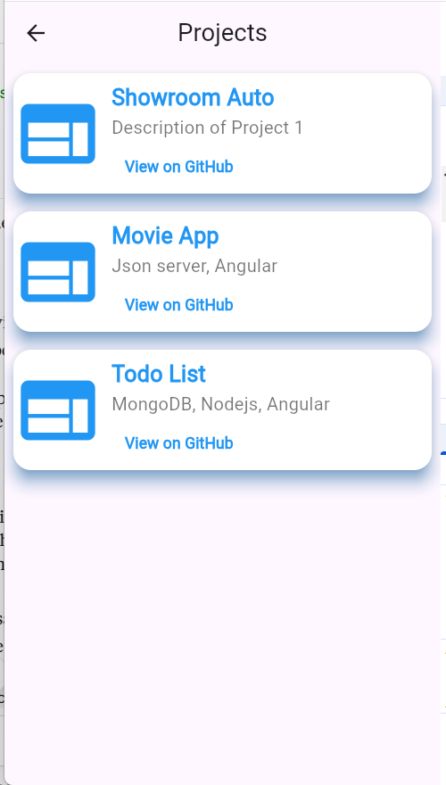
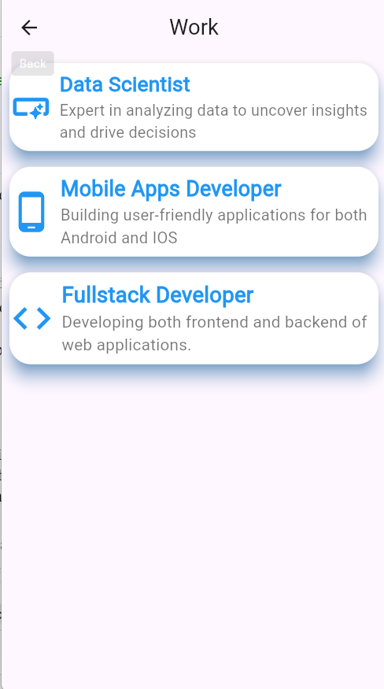
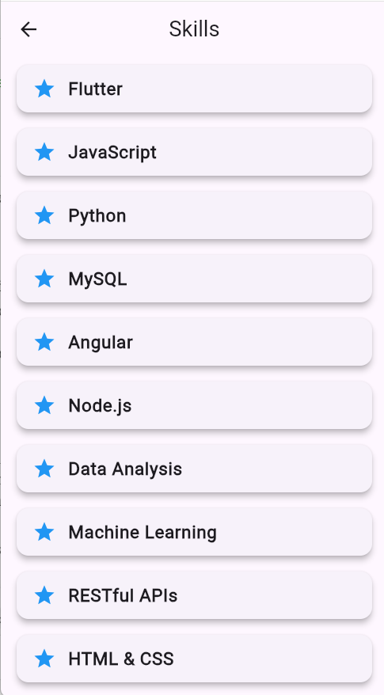
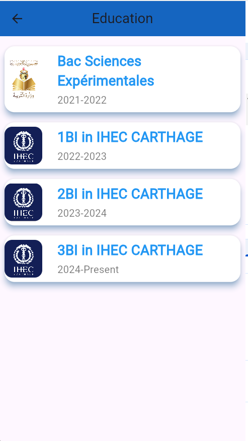
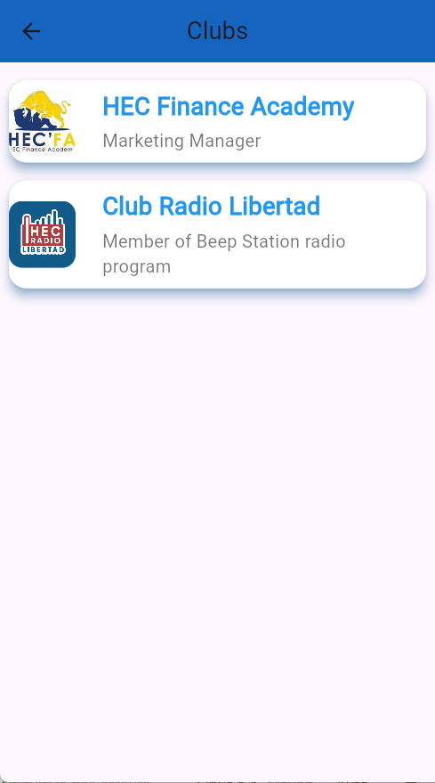

# Flutter Portfolio App

A personal portfolio built as a cross-platform Flutter app. It brings my profile, education, skills, clubs, and projects together in one mobile-style dashboard.

<p>
  
  
  
</p>

## Features

- **Dashboard:** a card-based menu that links to each section of the app
- **Profile:** photo and contact details
- **Work and skills:** the roles I focus on and the technologies I use
- **Education:** my academic path, year by year
- **Clubs:** the clubs I've joined, with a video that opens when you tap a club
- **Projects:** my projects, with buttons that open each GitHub repository
- **Personal pages:** hobbies and favorite food

## Screenshots

<p>
  
  
  
  
</p>

## Tech stack

- **Framework:** Flutter (Dart), Material Design
- **Video:** `video_player`
- **External links:** `url_launcher`
- **Icons:** `eva_icons_flutter`, `cupertino_icons`

## Getting started

You need the [Flutter SDK](https://docs.flutter.dev/get-started/install) with Dart 3.5.3 or later and Google Chrome. You don't need Android Studio to run the web version.

```bash
git clone https://github.com/wissou11/Portfolio-flutter.git
cd Portfolio-flutter
flutter pub get
flutter run -d chrome
```

To run it on an Android device or emulator, set up the Android toolchain, then use `flutter devices` to find your device and `flutter run -d <device-id>` to start the app.

## Project structure

```text
lib/
├── main.dart            App entry point
└── pages/
    ├── dahsboard/       Home menu
    ├── profile/
    ├── works/
    ├── skills/
    ├── education/
    ├── clubs/           Club list and video player
    ├── projects/        Project cards and GitHub links
    ├── hobby/
    └── favorite_food/
assets/                  Images and club videos
docs/screenshots/        Images used in this README
```
